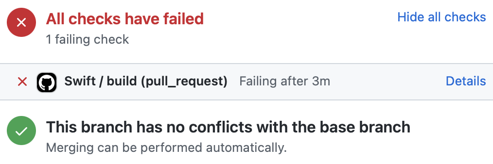
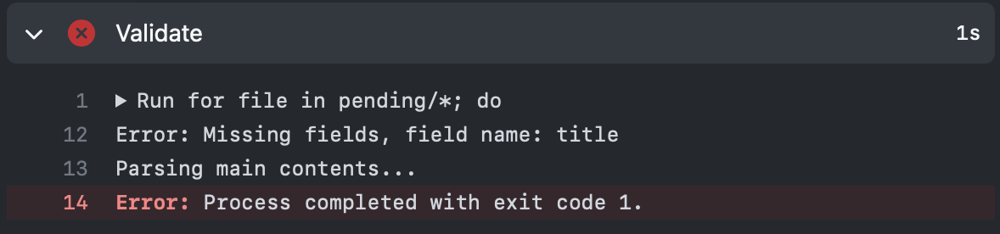
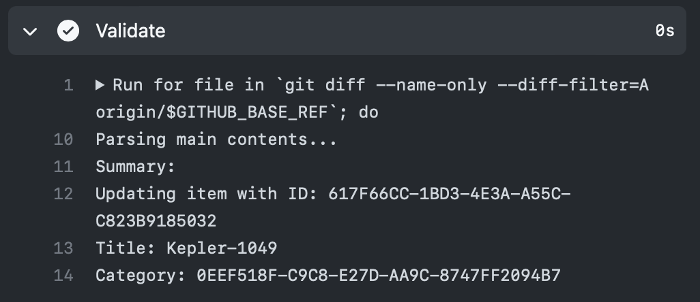

# Upload Celestia Add-ons

## Prepare Add-on

Check [Make an Add-on](https://celestia.mobi/make-addon) before submitting your add-on.

## Login with a GitHub Account

Go to the [Update Addon](https://celestia.mobi/submit-addon) page and login with your GitHub account.

## Fill in Information

Fill in the information about this add-on you are adding, changing, or removing.

Supported types are `addon`, `script`, and `hook`. Hooks require a nonempty `mainScriptName` (`main_script_name.txt` in ZIP submissions, or `main_script_name` in pending CloudKit records) pointing to a file relative to the root of `addon.zip`. The path must already be normalized: no `.` or `..` components, repeated `/` separators, or trailing `/`. Each folder and filename must match the case in the archive exactly. Directories and paths outside the add-on are rejected. Updates to hooks must also keep a valid main script; existing item types cannot be changed. Hooks are excluded from Steam Workshop sync.

Symbolic links are rejected in submission ZIPs and `addon.zip` for all types because they are not supported on Windows.

Use `celaddon://item?item=<ID>` for add-on references and `celguide://guide?guide=<ID>` for guide references. Direct `celestia.mobi/resources/item` and `celestia.mobi/resources/guide` web links are rejected in submitted text, including descriptions, notes, image captions, and additional HTML. The website converts native links to web links when displaying them in a browser.

## Submitting Add-ons

After clicking the `Submit` button, two pop-up windows will appear. On its first pop-up, simply enter the title of the addon you submitted

The second pop-up window is optional. State the changes you made on the addon's update on this window. Simply click `OK` if it is an entirely new addon submitted

The page will then automatically create a PR for you once the two pop-up windows are successfully filled up.

## Error Creating Pull Request

If the pull request is not created, there might be an issue with with your fork of this repository. The root cause might be that the size of your fork of this repository is getting too large. You can reset your fork of the repository by deleting it. Before deleting it, ensure that you don't have any open pull requests.

Go to your fork of this repository in https://github.com/YOUR_GITHUB_USERNAME/celestia-addon-validator.git \(replace YOUR_GITHUB_USERNAME with your GitHub user name\) and navigate to Settings. Find "Delete this repository" down the page and follow the instructions.

## Check Validation Result

Validation should only take a few minutes.

If validation fails, it will appear like this.

Click `Details`, and see where it goes wrong.

In this example, `title` is missing in submitting a new add-on. If it fails, Click `Close pull request` and start from the beginning.

In a successful validation, a summary will be displayed in details.

`Related Object Paths` lists objects in the add-on, check and ensure the list is correct.

## Upload to celestia.mobi

After it passes validation, a collaborator can merge this pull request. After the pull request is merged, more checks will be performed automatically and the add-on will be uploaded to celestia.mobi.

It may take up to about an hour after the pull request is merged for users to see the changes on celestia.mobi.
